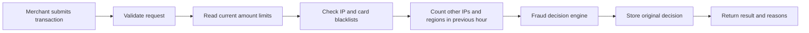

# Anti-Fraud System

[](https://github.com/adhambatlouni/anti-fraud-system/actions/workflows/ci.yml)
[](https://github.com/adhambatlouni/anti-fraud-system/releases/latest)

A rule-based Spring Boot API that evaluates payment risk, maintains fraud
blacklists, records transaction history, and adjusts amount thresholds from
specialist feedback.

The project began as the six-stage Hyperskill Anti-Fraud System and has been
rebuilt as a deployed, production-oriented backend portfolio project. It keeps
explicit SQL and `JdbcTemplate` instead of replacing the persistence layer with
JPA.

Start with the [architecture guide](docs/ARCHITECTURE.md) for the business
workflows, transaction boundaries, and recommended code-reading order.

> This project is designed for synthetic data. It stores and returns the
> 16-digit card identifiers required by the exercise and is not a PCI-compliant
> payment system. Never submit real card numbers.

## Live demo

The production API is deployed at
[anti-fraud-system.onrender.com](https://anti-fraud-system.onrender.com).
Its public health endpoint is available at
[`/actuator/health`](https://anti-fraud-system.onrender.com/actuator/health).

The free Render instance can take approximately one minute to wake after a
period of inactivity. The root URL opens the production Swagger UI, and the
API must be used with synthetic card identifiers only.

## What it demonstrates

- Java 25 and Spring Boot 4
- Role-based HTTP Basic authentication with BCrypt
- Explicit PostgreSQL queries through Spring JDBC
- Versioned PostgreSQL 18 schema migrations with Flyway
- Deterministic fraud rules and adaptive feedback thresholds
- Transactional row locking for exactly-once feedback
- Append-only, actor-attributed fraud operations audit events
- Bounded, filterable transaction investigation with masked card references
- Date-bounded operational metrics without card or IP data
- Immutable fraud decision evidence with rule-version snapshots
- Jakarta Bean Validation and `application/problem+json` errors
- JUnit 5, MockMvc, Spring Security tests, and Testcontainers
- Docker Compose, container health checks, and GitHub Actions
- OpenAPI 3 documentation and Swagger UI

## How a transaction is evaluated



The default amount thresholds are stored in PostgreSQL:

| Amount | Initial result |
|---:|---|
| `1`–`200` | `ALLOWED` |
| `201`–`1500` | `MANUAL_PROCESSING` |
| Greater than `1500` | `PROHIBITED` |

Other fraud signals can raise the severity:

- A blacklisted IP or stolen card produces `PROHIBITED`.
- Exactly two other IPs or regions used by the same card during the previous
  hour produces `MANUAL_PROCESSING`.
- More than two other IPs or regions produces `PROHIBITED`.
- The response reports only reasons belonging to the final severity, sorted
  alphabetically.

Every valid attempt is stored, including prohibited transactions. The original
decision is immutable.

## Roles

| Role | Responsibilities |
|---|---|
| `ADMINISTRATOR` | List users, change roles, lock/unlock accounts, delete users |
| `MERCHANT` | Submit transactions for evaluation |
| `SUPPORT` | Manage blacklists, inspect history, and submit feedback |

The first registered account becomes an enabled administrator. Later accounts
start as locked merchants until an administrator assigns the required role and
unlocks them.

## Run with Docker Compose

Requirements:

- Docker Desktop or another Docker Engine with Compose support

Create the local environment file:

```powershell
Copy-Item .env.example .env
```

Build and start the API and PostgreSQL:

```powershell
docker compose up --build
```

Available endpoints:

- API: `http://localhost:8080`
- Swagger UI: `http://localhost:8080/swagger-ui.html`
- OpenAPI JSON: `http://localhost:8080/v3/api-docs`
- Health: `http://localhost:8080/actuator/health`

The PostgreSQL volume preserves users, transactions, feedback, and adaptive
limits across container restarts.

## Run from IntelliJ IDEA

Requirements:

- Java 25
- PostgreSQL 18
- An empty PostgreSQL database, for example `antifraud`

Set these environment variables in the application run configuration:

```text
SPRING_PROFILES_ACTIVE=local
DB_URL=jdbc:postgresql://localhost:5433/antifraud
DB_USERNAME=your_application_user
DB_PASSWORD=your_application_password
```

Use the port configured by your PostgreSQL server. Flyway automatically creates
and upgrades the schema when the application starts.

The application listens on port `8080` by default.

## Production configuration

Activate the production profile and supply credentials through the deployment
environment:

```text
SPRING_PROFILES_ACTIVE=prod
DB_URL=jdbc:postgresql://database-host:5432/antifraud
DB_USERNAME=deployment_user
DB_PASSWORD=deployment_secret
API_DOCS_ENABLED=false
```

The production profile has no fallback database credentials, disables Flyway
clean operations, honors reverse-proxy forwarding headers, and prevents default
error pages from exposing messages or stack traces.

Swagger UI and `/v3/api-docs` are disabled in production unless
`API_DOCS_ENABLED=true` is explicitly provided. The health endpoint remains
available without exposing component details.

The portfolio Render deployment explicitly enables API documentation so the
root service URL can open Swagger UI. Authentication and role authorization
remain enforced on protected operations.

The repository includes a Render Blueprint for the Dockerized API. Follow the
[Render and Neon deployment guide](docs/DEPLOYMENT.md) to create the database,
provide secrets, deploy, and verify the public service.

## Synthetic demo workflow

Swagger UI provides an **Authorize** button for HTTP Basic credentials.

1. Register the first user through `POST /api/auth/user`. This user becomes the
   administrator.
2. Register merchant and support accounts through the same public endpoint.
3. Authenticate as the administrator, assign `SUPPORT` where required through
   `PUT /api/auth/role`, and unlock both accounts through
   `PUT /api/auth/access`.
4. Authenticate as the merchant and submit a transaction:

```json
{
  "amount": 800,
  "ip": "192.168.1.1",
  "number": "4000008449433403",
  "region": "EAP",
  "date": "2026-10-20T12:00:00"
}
```

The initial response is:

```json
{
  "result": "MANUAL_PROCESSING",
  "info": "amount"
}
```

5. Authenticate as support to inspect history, manage fraud blacklists, or
   submit feedback:

```json
{
  "transactionId": 1,
  "feedback": "ALLOWED"
}
```

Feedback can be submitted once. A valid correction updates the affected amount
thresholds in the same database transaction as the feedback record.

## API overview

| Method | Endpoint | Access | Purpose |
|---|---|---|---|
| `POST` | `/api/auth/user` | Public | Register a user |
| `GET` | `/api/auth/list` | Admin, Support | List users |
| `DELETE` | `/api/auth/user/{username}` | Admin | Delete a user |
| `PUT` | `/api/auth/role` | Admin | Change a user role |
| `PUT` | `/api/auth/access` | Admin | Lock or unlock a user |
| `POST` | `/api/antifraud/transaction` | Merchant | Evaluate and store a transaction |
| `PUT` | `/api/antifraud/transaction` | Support | Submit one-time feedback |
| `GET` | `/api/antifraud/history` | Support | Read all transaction history |
| `GET` | `/api/antifraud/history/{number}` | Support | Read history for a card |
| `GET` | `/api/v2/antifraud/transactions` | Support | Search masked transaction history with filters and pagination |
| `GET` | `/api/v2/antifraud/transactions/{id}/decision` | Support | Inspect the evidence captured for the original decision |
| `GET` | `/api/v2/antifraud/metrics` | Admin, Support | Aggregate decisions, review workload, regions, and active limits |
| `GET` | `/api/antifraud/audit?limit=50` | Admin, Support | Read recent audit events |
| `POST` | `/api/antifraud/suspicious-ip` | Support | Add a suspicious IP |
| `GET` | `/api/antifraud/suspicious-ip` | Support | List suspicious IPs |
| `DELETE` | `/api/antifraud/suspicious-ip/{ip}` | Support | Remove a suspicious IP |
| `POST` | `/api/antifraud/stolencard` | Support | Add a stolen card |
| `GET` | `/api/antifraud/stolencard` | Support | List stolen cards |
| `DELETE` | `/api/antifraud/stolencard/{number}` | Support | Remove a stolen card |

Common error responses use RFC 9457 Problem Details:

| Status | Meaning |
|---:|---|
| `400` | Malformed or invalid request |
| `401` | Missing, invalid, or locked credentials |
| `403` | Authenticated user lacks the required role |
| `404` | Resource not found |
| `409` | Duplicate resource or repeated feedback |
| `422` | Feedback matches the original decision |

## Database migrations

Flyway owns the PostgreSQL schema. Spring's `schema.sql` initialization is
disabled.

| Migration | Purpose |
|---|---|
| `V1__create_user_and_fraud_schema.sql` | Users, authorities, blacklists, transaction history, and adaptive limits |
| `V2__add_transaction_history_indexes.sql` | Correlation and card-history query indexes |
| `V3__create_audit_events.sql` | Append-only actor-attributed fraud operations history |
| `V4__add_transaction_search_indexes.sql` | Transaction search and filtering indexes |
| `V5__add_transaction_decision_snapshots.sql` | Immutable limits, signals, reasons, and rule version used for each decision |

Applied migrations should not be edited. Schema changes belong in a new
versioned migration.

## Tests

Run the complete suite:

```powershell
.\gradlew clean test
```

Docker must be running because integration tests start PostgreSQL 18 with
Testcontainers.

Build the executable application JAR:

```powershell
.\gradlew bootJar
```

The suite covers validators, decision precedence, feedback calculations,
Flyway migrations, authorization, HTTP error contracts, PostgreSQL fraud
queries, audit redaction, and concurrent feedback submissions.

## Project structure

```text
src/main/java/com/adham/antifraudsystem/
├── config/       security, passwords, and OpenAPI
├── controller/   REST endpoints
├── dto/          validated request and response records
├── exception/    centralized Problem Detail mapping
├── model/        roles, regions, and fraud result types
├── service/      business rules and JDBC persistence
└── validation/   IPv4 and Luhn validation

src/main/resources/
├── application.properties
└── db/migration/
```

## Current scope

The [v2.1.0 portfolio release](https://github.com/adhambatlouni/anti-fraud-system/releases/tag/v2.1.0)
includes PostgreSQL 18, Flyway, database-backed tests, concurrency coverage,
Docker Compose, CI, structured errors, OpenAPI documentation, append-only audit
events, bounded transaction search, operational metrics, immutable decision
evidence, and a verified Render and Neon deployment.

An optional monitoring dashboard may be added later. JWT and JPA are not
required by the current API or domain model and will only be introduced when a
concrete product requirement justifies them.
