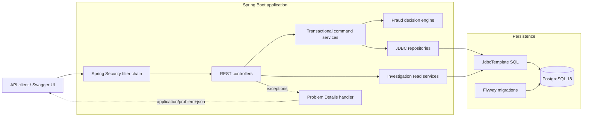
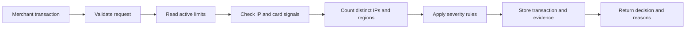
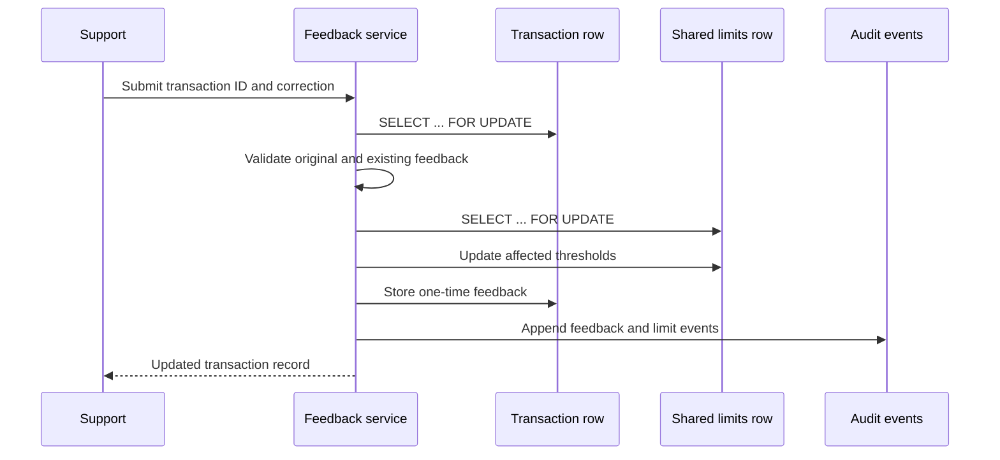

<!--suppress HtmlDeprecatedAttribute -->
<div align="center">

# Anti-Fraud System

**An explainable Spring Boot fraud decision API with deterministic risk rules, adaptive thresholds, auditable operations, PostgreSQL concurrency controls, and container-backed verification.**

[](https://github.com/adhambatlouni/anti-fraud-system/actions/workflows/ci.yml)
[](https://anti-fraud-system.onrender.com/)
[](https://github.com/adhambatlouni/anti-fraud-system/releases/latest)


[Live API](#live-api) · [Architecture](#architecture) · [Decision model](#decision-model) · [Demo](#try-the-fraud-workflow) · [API](#api-reference) · [Testing](#testing-and-ci) · [Decisions](#engineering-decisions)

</div>

---

Anti-Fraud System is a Spring Boot REST API that evaluates synthetic payment
transactions, correlates recent card activity, manages fraud signals, and
supports specialist review. Each valid attempt receives one of three decisions:
`ALLOWED`, `MANUAL_PROCESSING`, or `PROHIBITED`.

The application preserves the evidence behind every decision, applies
specialist feedback exactly once, updates shared amount thresholds safely, and
records sensitive operational changes in an append-only audit trail. It uses
explicit Spring JDBC repositories so the SQL, locking strategy, and database
boundaries remain visible.

> This project accepts synthetic card identifiers for demonstration purposes.
> It is not a PCI-compliant payment system and must never receive real card
> numbers.

## Live API

The public deployment runs the Dockerized Java application on Render and stores
its state in a persistent Neon PostgreSQL database.

- **Interactive API:** [Open the live API and Swagger UI](https://anti-fraud-system.onrender.com/)
- **Machine-readable contract:** [OpenAPI JSON](https://anti-fraud-system.onrender.com/v3/api-docs)
- **Service readiness:** [Health endpoint](https://anti-fraud-system.onrender.com/actuator/health)

The service root redirects to Swagger UI. Protected operations still require
the appropriate HTTP Basic credentials and role. The free Render instance may
take about one minute to answer its first request after a period of inactivity.

## Engineering at a glance

| Area | Implementation |
|---|---|
| **Decisioning** | Deterministic severity precedence with sorted, highest-severity reasons |
| **Correlation** | Distinct IP and region activity for the same card inside an inclusive one-hour window |
| **Explainability** | Immutable snapshots of applied limits, rule version, reasons, and correlation signals |
| **Adaptive feedback** | One-time specialist feedback recalculates future amount thresholds with exact decimal arithmetic |
| **Concurrency** | PostgreSQL row and table locking serialize feedback, limit updates, and first-user registration |
| **Auditability** | Append-only, actor-attributed events for blacklist, feedback, and limit operations |
| **Persistence** | PostgreSQL 18, Spring JDBC repositories, explicit SQL, constraints, triggers, and Flyway migrations |
| **Security** | Stateless Spring Security, BCrypt, locked-account handling, and role-specific routes |
| **API contract** | OpenAPI, Swagger UI, Bean Validation, RFC 9457 Problem Details, bounded search, controlled sorting |
| **Verification** | JUnit 5, MockMvc, Spring Security tests, Testcontainers, PostgreSQL, and Flyway |
| **Delivery** | Multi-stage non-root image, health-aware Docker Compose, Render Blueprint, Neon, and GitHub Actions |

## Architecture



Controllers define the HTTP boundary. Transactional services coordinate fraud
workflows and policy, while repositories own reusable persistence and row
locking. Specialized search, metrics, and decision-inspection queries remain in
focused read services because their SQL directly defines their API projections.

The [architecture guide](docs/ARCHITECTURE.md) explains the workflows,
transaction boundaries, persistence choices, and recommended code-reading
order in more detail.

## Decision model

A merchant submits an amount, IPv4 address, synthetic card identifier, region,
and timestamp. The evaluation workflow validates the request before reading or
writing fraud data.



The initial amount thresholds are persisted in PostgreSQL:

| Amount | Initial decision |
|---:|---|
| `1` to `200` | `ALLOWED` |
| `201` to `1500` | `MANUAL_PROCESSING` |
| Greater than `1500` | `PROHIBITED` |

Other signals can raise the decision severity:

| Signal | Decision impact |
|---|---|
| IP appears in the suspicious-IP blacklist | `PROHIBITED` |
| Card appears in the stolen-card blacklist | `PROHIBITED` |
| Exactly two other IPs for the same card in the previous hour | `MANUAL_PROCESSING` |
| More than two other IPs for the same card in the previous hour | `PROHIBITED` |
| Exactly two other regions for the same card in the previous hour | `MANUAL_PROCESSING` |
| More than two other regions for the same card in the previous hour | `PROHIBITED` |

Prohibited signals take precedence over manual-review signals. The response
contains only reasons belonging to the final severity, sorted alphabetically.
Every valid attempt is stored, including prohibited transactions.

Each transaction also captures the limits, blacklist flags, correlation
counts, reasons, and rule version used during evaluation. Historical evidence
is read from that immutable snapshot and is never recomputed against newer
limits or blacklists.

## Feedback and concurrency

Support users can submit one feedback decision for a stored transaction. The
original decision remains unchanged; valid feedback adjusts thresholds used by
future transactions.

| Original decision | Feedback | Threshold change |
|---|---|---|
| `ALLOWED` | `MANUAL_PROCESSING` | Decrease allowed limit |
| `ALLOWED` | `PROHIBITED` | Decrease allowed and manual limits |
| `MANUAL_PROCESSING` | `ALLOWED` | Increase allowed limit |
| `MANUAL_PROCESSING` | `PROHIBITED` | Decrease manual limit |
| `PROHIBITED` | `ALLOWED` | Increase allowed and manual limits |
| `PROHIBITED` | `MANUAL_PROCESSING` | Increase manual limit |

Feedback identical to the original decision receives `422 Unprocessable
Content`. Repeated feedback receives `409 Conflict`.

Threshold changes use exact decimal arithmetic and ceiling rounding:

```text
increase = ceil(0.8 * currentLimit + 0.2 * transactionAmount)
decrease = ceil(0.8 * currentLimit - 0.2 * transactionAmount)
```



The transaction row lock enforces exactly-once feedback. The limits row lock
serializes changes to shared thresholds. Feedback, threshold updates, and audit
events commit or roll back together.

## Investigation and operations

Support and administrator workflows expose stored facts without leaking full
card identifiers through the newer investigation APIs.

| Capability | Endpoint | Safety property |
|---|---|---|
| Transaction search | `GET /api/v2/antifraud/transactions` | Bounded pages, allow-listed sorting, masked card references |
| Decision inspection | `GET /api/v2/antifraud/transactions/{id}/decision` | Stored evidence without card or IP data |
| Audit trail | `GET /api/antifraud/audit` | Actor-attributed, append-only operational history |
| Operational metrics | `GET /api/v2/antifraud/metrics` | Date-bounded aggregates without card or IP data |

Audit history is separate from transaction history. Transactions record payment
attempts; audit events record who changed operational state, including
blacklists, feedback, and limits.

## Try the fraud workflow

Use a fresh local database for this deterministic walkthrough.

1. Register three accounts with `POST /api/auth/user`. The first becomes the
   enabled administrator; the others start as locked merchants.
2. Authenticate as the administrator, assign one account the `SUPPORT` role,
   and unlock the merchant and support accounts.
3. Authenticate as the merchant and submit an amount of `800`. With the initial
   limits, the result is `MANUAL_PROCESSING` with reason `amount`.
4. Submit low-value transactions for the same card from successive IPs within
   one hour. The third distinct IP produces manual review; the fourth produces
   prohibition through `ip-correlation`.
5. Authenticate as support and inspect the stored decision evidence.
6. Submit `ALLOWED` feedback for the amount-based manual decision. The allowed
   threshold changes from `200` to `320`.
7. Inspect the audit trail and operational metrics to see the feedback event,
   limit update, decision distribution, and review workload.

Example merchant request:

```json
{
  "amount": 800,
  "ip": "192.168.1.10",
  "number": "4000008449433403",
  "region": "EAP",
  "date": "2026-10-20T12:00:00"
}
```

The card number above is a synthetic Luhn-valid test identifier.

## Security and roles

| Role | Main responsibilities |
|---|---|
| `ADMINISTRATOR` | Manage users, roles, and account access; read metrics and audit events |
| `MERCHANT` | Submit transactions for fraud evaluation |
| `SUPPORT` | Maintain blacklists, review history, inspect decisions, and submit feedback |

Passwords are stored as BCrypt hashes. Spring Security distinguishes missing or
invalid authentication (`401`) from an authenticated caller without the
required role (`403`). The application intentionally retains stateless HTTP
Basic authentication because it suits the current backend and Swagger workflow.

## API reference

The live [Swagger UI](https://anti-fraud-system.onrender.com/) is the complete,
executable API reference. The main route groups are:

| Area | Routes | Access |
|---|---|---|
| Accounts | `/api/auth/**` | Public registration; admin and support management |
| Evaluation and review | `/api/antifraud/transaction`, `/api/antifraud/history/**` | Merchant submission; support review |
| Fraud signals | `/api/antifraud/suspicious-ip/**`, `/api/antifraud/stolencard/**` | Support |
| Investigation | `/api/v2/antifraud/transactions/**` | Support |
| Operations | `/api/v2/antifraud/metrics`, `/api/antifraud/audit` | Administrator, Support |

Validation and domain failures use `application/problem+json` and distinguish
`400`, `401`, `403`, `404`, `409`, and `422` responses.

## Quick start

With Git and Docker Desktop installed, the Compose stack starts the API and
PostgreSQL, waits for database readiness, and applies Flyway migrations.

### 1. Clone and configure

```bash
git clone https://github.com/adhambatlouni/anti-fraud-system.git
cd anti-fraud-system
```

```powershell
Copy-Item .env.example .env
```

Use `cp .env.example .env` on macOS, Linux, or Git Bash. The defaults are for
local development; change `POSTGRES_PASSWORD` in shared environments.

### 2. Start the stack

```bash
docker compose up --build -d
docker compose ps
docker compose logs -f api
```

Once the application is healthy:

- **Swagger UI:** [http://localhost:8080/swagger-ui/index.html](http://localhost:8080/swagger-ui/index.html)
- **OpenAPI JSON:** [http://localhost:8080/v3/api-docs](http://localhost:8080/v3/api-docs)
- **Health:** [http://localhost:8080/actuator/health](http://localhost:8080/actuator/health)
- **PostgreSQL:** `localhost:5432`

### 3. Stop the stack

```bash
docker compose down
```

The named volume preserves data between container recreations. Use
`docker compose down --volumes` only when you intentionally want a clean local
database.

## Database migrations

Flyway owns schema evolution. Applied migrations are immutable; each schema
change belongs in a new versioned file.

| Migration | Change |
|---|---|
| `V1__create_user_and_fraud_schema.sql` | Users, authorities, blacklists, transactions, and adaptive limits |
| `V2__add_transaction_history_indexes.sql` | Correlation and card-history indexes |
| `V3__create_audit_events.sql` | Append-only operational audit events |
| `V4__add_transaction_search_indexes.sql` | Search and reporting indexes |
| `V5__add_transaction_decision_snapshots.sql` | Immutable limits, signals, reasons, and rule version |

PostgreSQL constraints and triggers protect the single limits row, valid fraud
results, and immutable decision evidence. Transactional row locks enforce
one-time feedback and serialize shared threshold updates.

## Testing and CI

Docker must be running because the integration suite starts disposable
`postgres:18` containers.

Windows:

```powershell
.\gradlew.bat clean test
```

macOS or Linux:

```bash
./gradlew clean test
```

The suite covers:

- validation, amount rules, severity precedence, and sorted explanations;
- same-card isolation and one-hour correlation boundaries;
- feedback transitions, row locking, and concurrent administrator registration;
- security, errors, Flyway, audit redaction, investigation APIs, and snapshots.

GitHub Actions runs `./gradlew clean check bootJar --no-daemon --stacktrace`
for pull requests targeting `main` and pushes to `main`. The workflow uses Java
25, caches Gradle dependencies, grants read-only repository access, and cancels
superseded runs on the same ref.

## Engineering decisions

| Decision | Reason |
|---|---|
| **Spring JDBC instead of JPA** | Correlation, aggregation, row locking, and projection SQL remain explicit and reviewable |
| **Concrete repositories with focused read services** | Reusable persistence is separated without creating interfaces that have no alternative implementation |
| **Immutable decision snapshots** | Historical decisions stay explainable after limits and blacklists change |
| **Pessimistic locking for feedback** | One-time feedback and shared threshold changes require serialization at the database boundary |
| **Separate audit and transaction histories** | Payment attempts and operator actions have different meaning, access patterns, and retention concerns |
| **HTTP Basic for the current API** | Stateless role authentication supports the backend and Swagger workflow without an unused token subsystem |
| **Bounded pages and sort allow-list** | Investigation clients cannot request unbounded data or arbitrary SQL ordering |
| **Synthetic identifiers and masked projections** | The portfolio demo limits exposure while making no PCI-compliance claim |
| **PostgreSQL-backed integration tests** | Tests exercise the same locking, constraints, migrations, and SQL semantics used in deployment |
| **Health-aware container startup** | The API waits for PostgreSQL readiness rather than relying on startup timing |

The project evolved from the six-stage Hyperskill Anti-Fraud System into a
deployed backend with explicit persistence boundaries, explainable decisions,
concurrency coverage, operational reads, containers, and CI.

## Deployment

The repository includes a Render Blueprint for the Dockerized API. Production
uses environment-provided Neon credentials, disables Flyway clean operations,
honors proxy forwarding headers, and suppresses error details and stack traces.

See the [Render and Neon deployment guide](docs/DEPLOYMENT.md) for configuration
and verification. The current portfolio release is
[v2.1.0](https://github.com/adhambatlouni/anti-fraud-system/releases/tag/v2.1.0),
and ongoing development uses version `2.2.0-SNAPSHOT`.

## Project structure

```text
src/
├── main/
│   ├── java/com/adham/antifraudsystem/
│   │   ├── config/       # security, passwords, and OpenAPI
│   │   ├── controller/   # REST endpoints
│   │   ├── dto/          # validated API records grouped by area
│   │   ├── exception/    # Problem Details mapping
│   │   ├── model/        # roles, regions, and fraud results
│   │   ├── repository/   # reusable JDBC persistence and row locking
│   │   ├── service/      # workflows, decisions, feedback, and read models
│   │   └── validation/   # IPv4 and Luhn rules
│   └── resources/
│       ├── application*.properties
│       └── db/migration/ # versioned PostgreSQL schema
└── test/                 # unit and container-backed integration tests

.github/workflows/ci.yml  # pull-request and main verification
compose.yaml              # API and PostgreSQL development stack
Dockerfile                # multi-stage Java 25 image
render.yaml               # Render web-service definition
docs/ARCHITECTURE.md      # workflows and code-reading guide
docs/DEPLOYMENT.md        # Render and Neon deployment guide
.env.example              # local configuration template
```

---

<!--suppress HtmlDeprecatedAttribute -->
<div align="center">

Built by **[Adham Batlouni](https://github.com/adhambatlouni)**

</div>
