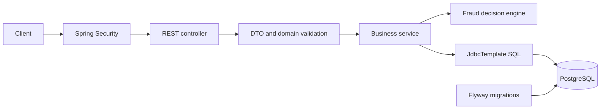
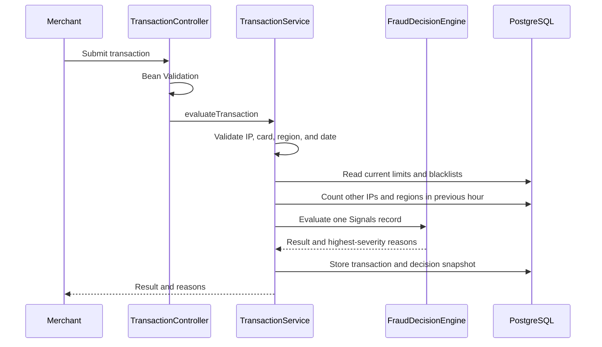
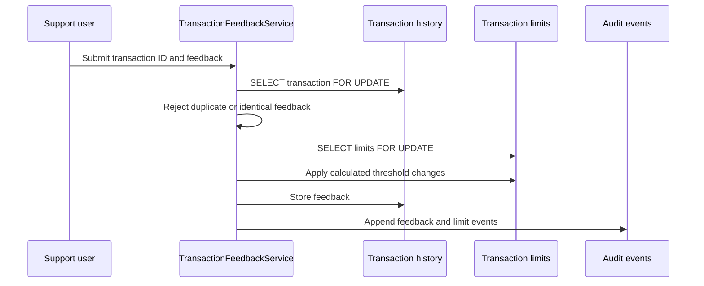

# Architecture Guide

This document explains the project as a small set of business workflows. Read
it before studying individual classes.

## What the application does

The API evaluates synthetic payment transactions for fraud risk. A merchant
submits an amount, IP address, card identifier, region, and timestamp. The
application combines amount thresholds, blacklists, and recent card activity
to return one of three decisions:

- `ALLOWED`
- `MANUAL_PROCESSING`
- `PROHIBITED`

Support users maintain blacklists, inspect transactions, and correct decisions
through feedback. Feedback changes the amount thresholds used for future
transactions. It never changes an existing transaction's original decision.

## Main architecture

The packages have conventional responsibilities:

| Package | Responsibility |
|---|---|
| `config` | Security, password encoding, and OpenAPI configuration |
| `controller` | HTTP routes and request/response handling |
| `dto` | API request and response records grouped by area |
| `exception` | Consistent Problem Detail error responses |
| `model` | Small domain enums such as role, region, and result |
| `service` | Fraud rules, transactions, feedback, and JDBC queries |
| `validation` | Algorithmic IPv4 and Luhn validation |

Services are kept separate because evaluation, feedback, audit, search, and
reporting change for different business reasons. Combining them would create
one large class with unrelated SQL and rules.

## Workflow 1: transaction evaluation

The primary route is `POST /api/antifraud/transaction`, available to merchants.

`TransactionService` orchestrates the use case. It does not contain the result
precedence rules; those belong to `FraudDecisionEngine`, which is deterministic
and can be unit tested without Spring or a database.

The engine applies this precedence:

1. Any prohibited signal produces `PROHIBITED`.
2. Otherwise, any manual signal produces `MANUAL_PROCESSING`.
3. Otherwise, the result is `ALLOWED`.

Only reasons for the final severity are returned. For example, a manual amount
signal is not included when a blacklisted IP makes the result prohibited.

The transaction row also captures the limits, blacklist flags, correlation
counts, reasons, and rule version used during evaluation. PostgreSQL prevents
these snapshot columns from being modified later.

## Workflow 2: support feedback

The route is `PUT /api/antifraud/transaction`, available to support users.

The complete workflow runs in one database transaction. Row locks guarantee
that concurrent feedback cannot be applied twice and that updates to the
shared limits are serialized.

`FeedbackLimitCalculator` contains only the formulas. The service handles
locking, validation, persistence, and audit recording.

## Workflow 3: investigation

Support users have three read models:

- `/api/v2/antifraud/transactions` provides bounded filtering, sorting, and
  pagination with masked card references.
- `/api/v2/antifraud/transactions/{id}/decision` returns the evidence captured
  during the original evaluation without exposing the card or IP.
- `/api/antifraud/audit` returns append-only actor-attributed operational
  events.

Administrators and support users can read `/api/v2/antifraud/metrics` for
date-bounded aggregate counts. Metrics never return card or IP data.

These endpoints read stored facts. They do not recompute historical decisions
using today's limits or blacklists.

## Authentication and authorization

The project intentionally keeps stateless HTTP Basic authentication from the
learning-project contract. Passwords are stored as BCrypt hashes.

- The first registered user becomes an enabled administrator.
- Later users start as locked merchants.
- Administrators assign roles and unlock accounts.
- Spring Security checks route permissions before controllers run.

JWT is not included because the current backend and Swagger workflow do not
require a token service. Adding JWT only as a portfolio keyword would increase
code without improving the fraud domain.

## Database migrations

| Version | Purpose |
|---|---|
| V1 | Users, authorities, blacklists, transactions, and limits |
| V2 | Correlation and card-history indexes |
| V3 | Append-only actor-attributed audit events |
| V4 | Search and reporting indexes |
| V5 | Immutable decision evidence snapshots |

Flyway applies these migrations in order. Existing migration files must not be
edited after they have been applied to a persistent database.

## Why Spring JDBC

Spring JDBC keeps the SQL visible. This matters here because the project uses:

- `COUNT(DISTINCT ...)` correlation queries
- explicit ordering and bounded pagination
- PostgreSQL aggregate filters
- `SELECT ... FOR UPDATE` concurrency control
- database constraints and append-only triggers

JPA would be valid, but it would hide one of this project's distinguishing
skills without solving a current problem.

## What to explain in an interview

Be ready to answer these questions:

**How is a fraud result chosen?**

Describe the signals record, severity precedence, and sorted reasons in
`FraudDecisionEngine`.

**Why is feedback concurrency-safe?**

The service locks the transaction row to enforce one-time feedback and locks
the shared limits row before calculating and writing new thresholds.

**Why store decision snapshots?**

Limits and blacklists change. Stored evidence explains the original decision
without incorrectly recomputing it using newer state.

**Why are audit events separate from transaction history?**

Transaction history records payment attempts. Audit history records who
changed operational state, such as blacklists, feedback, and limits.

**How is sensitive data handled?**

The exercise accepts synthetic card identifiers. Investigation responses and
audit events mask them, metrics contain no card or IP data, and examples must
never use real payment data. The application does not claim PCI compliance.

**What makes the project production-oriented?**

PostgreSQL migrations, database constraints, transactional locking,
Testcontainers, authorization regression tests, structured errors, Docker,
CI, health checks, and accurate OpenAPI documentation.

## Recommended reading order

1. `SecurityConfig`
2. `TransactionController`
3. `TransactionService`
4. `FraudDecisionEngine`
5. `TransactionHistoryService`
6. `TransactionFeedbackService`
7. `FraudLimitService` and `FeedbackLimitCalculator`
8. Flyway migrations V1 through V5
9. Integration tests for decisions, feedback concurrency, and API contracts

After this sequence, search, metrics, audit, and decision inspection should be
straightforward because they build on the stored transaction data.
